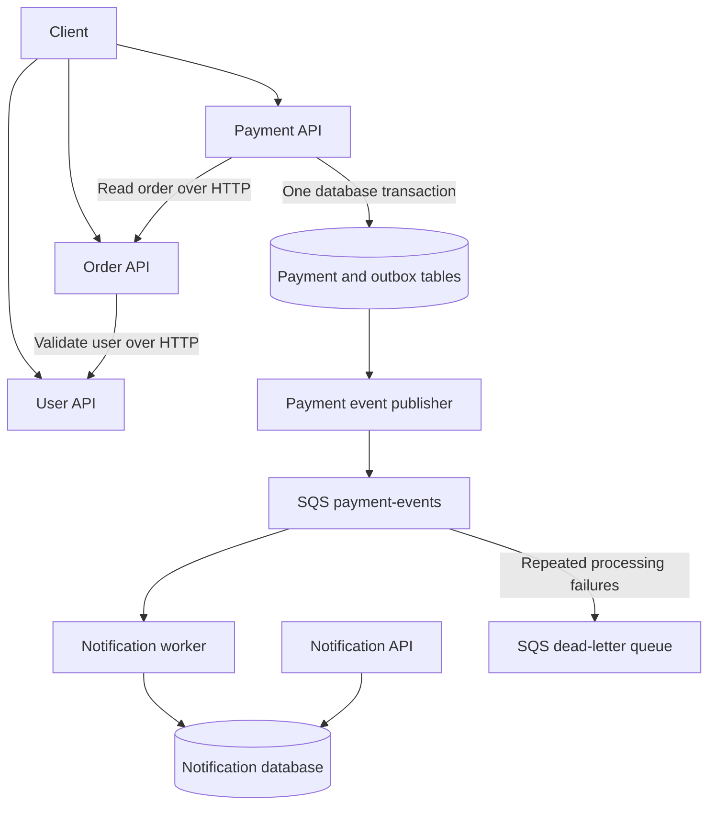

# DevOps Enterprise Project

A small commerce backend built as the application foundation for a DevOps learning project. The goal is to build a working application first, then use it to practise infrastructure provisioning, delivery automation, observability, and reliability engineering.

The application supports creating users, placing orders, processing mock payments, and generating asynchronous payment notifications. It uses Python, FastAPI, SQLAlchemy, PostgreSQL, and SQS through LocalStack for local development.

## Current milestone

The four application APIs, payment outbox publisher, and notification worker are implemented and wired together in Docker Compose. Payment processing and email delivery are simulated. End-to-end and messaging failure tests remain to be added before considering the application milestone complete.

| Area | Current state |
| --- | --- |
| Users | Create and retrieve users; reject duplicate email addresses |
| Orders | Validate the user, calculate item totals, and store an order |
| Payments | Validate the order, simulate payment, enforce idempotency, and persist an outbox event |
| Notifications | Consume SQS events, deduplicate by event ID, and store simulated email notifications |
| Local environment | Docker Compose, PostgreSQL, LocalStack SQS, and a dead-letter queue |
| Operational basics | Health endpoints, structured logs, and HTTP metrics endpoints |
| Automated tests | Order and payment unit tests; notification test file is still empty |
| DevOps platform | Planned; no Terraform, Kubernetes deployment, or CI/CD implementation yet |

## Application flow



1. Create a user with a name and email address.
2. Create an order for that user, supplying item SKUs, quantities, and prices in cents. The order starts in `pending_payment` status.
3. Submit the order for payment with an `Idempotency-Key` header. The payment service reads the order and uses a mock processor that succeeds for a valid positive amount.
4. Save the payment and a `payment.succeeded` outbox event in the same PostgreSQL transaction.
5. A separate publisher reads unpublished outbox rows and sends their payloads to SQS.
6. The notification worker validates each event and saves a notification. The notification API exposes those records for retrieval.

Each API owns a separate database within one local PostgreSQL instance: `user_db`, `order_db`, `payment_db`, and `notification_db`.

## Outbox and SQS behavior

The transactional outbox keeps a committed payment and its event together. Publishing to SQS happens asynchronously, so a temporary queue outage does not require the payment request to publish successfully before returning.

- The publisher selects the oldest unpublished event, sends it, and then records `published_at`. It also tracks publication attempts and retries failures.
- Events contain an `event_id`, `event_type`, `schema_version`, `occurred_at`, and payment data. The current event type is `payment.succeeded`, with schema version `1`.
- Delivery can happen more than once, including if the publisher stops after sending but before recording success. The notification table has a unique `event_id` constraint to prevent duplicate records.
- The worker deletes a message after successfully storing its notification, or after recognizing an already processed event. Invalid messages and processing failures are left for retry.
- LocalStack creates `payment-events` and `payment-events-dlq` by default, with a redrive policy of `maxReceiveCount: 3`.
- Local defaults use a 10-second long poll and a deliberately short 5-second visibility timeout for failure testing.

Notifications use the `simulated_email` channel: they are database records, not delivered emails. The publisher currently has no row-claiming or locking mechanism for coordinating multiple publisher instances.

## Run locally

Prerequisites: Docker with Docker Compose. The walkthrough below also uses `curl` and `jq`.

From the repository root, create your local environment file if one does not already exist:

```bash
cp -n .env.example .env
```

Review `.env` before starting. The example contains local database credentials and dummy AWS credentials for LocalStack. Compose also references `LOCALSTACK_AUTH_TOKEN`, which is absent from `.env.example`; supply it in `.env` if required by the LocalStack image you use. The image currently uses the unpinned `latest` tag.

```bash
docker compose up --build -d
docker compose ps
docker compose logs -f payment-event-publisher notification-worker
```

PostgreSQL initialization creates the four databases on the first start with an empty data volume. Application tables are created at startup using SQLAlchemy `create_all`; versioned database migrations are not implemented. Keep the database names in `.env` aligned with `docker/postgres/init.sql`.

| Component | Host address | API documentation |
| --- | --- | --- |
| User API | `http://localhost:8001` | [Swagger UI](http://localhost:8001/docs) |
| Order API | `http://localhost:8002` | [Swagger UI](http://localhost:8002/docs) |
| Payment API | `http://localhost:8003` | [Swagger UI](http://localhost:8003/docs) |
| Notification API | `http://localhost:8004` | [Swagger UI](http://localhost:8004/docs) |
| LocalStack | `http://localhost:4566` | — |

The publisher and notification worker run as separate containers without public HTTP ports.

To stop the stack while retaining its named volumes:

```bash
docker compose down
```

## Try the application

Run these commands in the same shell once the APIs are ready. Each run creates a new demo user and payment key.

```bash
DEMO_ID=$(python3 -c 'import uuid; print(uuid.uuid4())')

USER_ID=$(curl --fail-with-body -sS http://localhost:8001/users \
  -H 'Content-Type: application/json' \
  -d "{\"name\":\"Demo User\",\"email\":\"demo-${DEMO_ID}@example.com\"}" \
  | jq -er '.id')

ORDER_ID=$(curl --fail-with-body -sS http://localhost:8002/orders \
  -H 'Content-Type: application/json' \
  -d "{\"user_id\":\"${USER_ID}\",\"items\":[{\"sku\":\"demo-item\",\"quantity\":2,\"unit_price_cents\":1500}]}" \
  | jq -er '.id')

curl --fail-with-body -sS http://localhost:8003/payments \
  -H 'Content-Type: application/json' \
  -H "Idempotency-Key: demo-${DEMO_ID}" \
  -d "{\"order_id\":\"${ORDER_ID}\"}" | jq

curl --fail-with-body -sS \
  "http://localhost:8004/notifications?user_id=${USER_ID}" | jq
```

The demo also requires Python 3 to generate a unique ID. The expected payment amount is `3000` cents and its status is `succeeded`. Notification processing is asynchronous: if the final response is an empty list, repeat the notification request after a few seconds.

Repeating the payment request with the same key and order returns the existing payment with HTTP `200`, rather than creating another payment. Reusing the key for another order, or submitting a new key for an already paid order, returns HTTP `409`.

The order itself currently remains `pending_payment`; updating its status after payment is still outstanding.

## Health and observability

All four APIs expose:

- `/health/live`: process liveness.
- `/health/ready`: database connectivity.
- `/metrics`: Prometheus-format HTTP metrics.

Order, payment, and notification APIs also expose `/health/dependencies` for their respective user-service, order-service, and SQS dependencies. API readiness does not prove that the asynchronous workers are successfully processing events.

Services emit structured logs. A full metrics collection stack, dashboards, alerting, and distributed tracing setup are not implemented.

## Tests

Existing unit tests cover order totals, user lookup behavior, payment validation, the mock payment processor, and order lookup behavior. Run each service's tests separately because the services use the same `app` package name.

For example, from the repository root:

```bash
cd services/order-service
python3 -m venv .venv
source .venv/bin/activate
python -m pip install -r requirements.txt
python -m pytest tests
deactivate
cd ../..
```

Repeat with `services/payment-service` for the payment tests. Container images currently copy application code only, so they do not include the test directories.

There are no implemented notification tests, outbox publisher tests, or end-to-end tests yet. The walkthrough above describes the intended manual check; it is not an automated verification of delivery, retries, or dead-letter handling.

## Repository layout

```text
services/
  user-service/          User API
  order-service/         Order API and unit tests
  payment-service/       Payment API, outbox publisher, and unit tests
  notification-service/ Notification API and SQS worker
docker/
  postgres/init.sql     Local database creation
  localstack/init-aws.sh SQS queue and dead-letter queue creation
docs/                   Architecture, ADR, security, and reliability placeholders
scripts/                Placeholder for automation scripts
tests/                  Placeholder for shared/integration tests
docker-compose.yml      Local application stack
.env.example            Local configuration template
```

The `Makefile` and documents under `docs/` are currently empty scaffolding.

## Remaining work

Before closing the application milestone:

- Verify the complete user → order → payment → notification flow.
- Add tests for atomic payment/outbox persistence, duplicate events, publication retries, worker recovery, and dead-letter handling.
- Implement the order transition from `pending_payment` to `paid`.
- Add database migrations and define publisher coordination before scaling publishers.

The next DevOps phase is intended to build on this application. Placeholder ADR filenames point toward Terraform, separate CI and CD, Argo CD, Gateway API, EKS Pod Identity, Loki, and image signing. These are planning topics, not completed deployments or documented decisions.

Real payment and email providers remain optional extensions. Authentication and authorization are not implemented in the current application.
